# 手把手教程：用标注工具做一张滑坡卡

这篇教程带你从零开始，用 `annotate_scene.exe` 把仓库里那张滑坡卡（虚构山村，`tools/scenes/landslide_village/`）重新做一遍。每一步都会写清楚：

- **点哪里**：每一步都有截图，图上用圆圈数字标出点击顺序，表格里给出坐标；
- **参数填什么**：每一步都列出全部参数；
- **做完应该看到什么**。

跟着做一遍大约 40 分钟。做完以后，换成你们自己的图片，用同样的方法就能做出新卡。

> 教程里的每一步，都已经在工具里按原样操作过一遍，并生成了能上板的 PIC1–4.BMP。截图就是那次操作的结果。

---

## 第 0 步：先看要做成什么样

一张卡有 4 张图，按顺序在板上播放，每张图约 8 秒：

| PIC1 致因：暴雨，隐患坡体黄框闪烁 | PIC2 发生：坡顶拉裂、坡体下滑 |
|---|---|
| 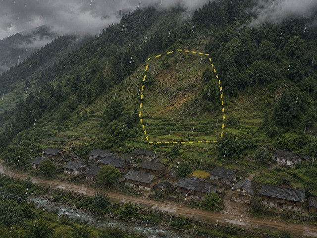 | 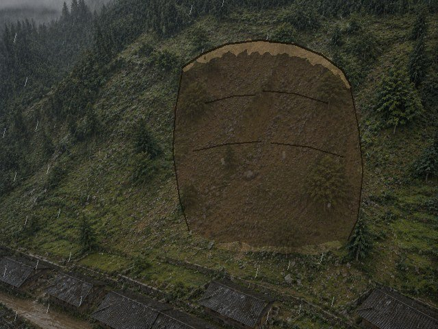 |
| **PIC3 后果：堆积体掩埋坡脚** | **PIC4 撤离：避开危险区，到避险棚** |
| 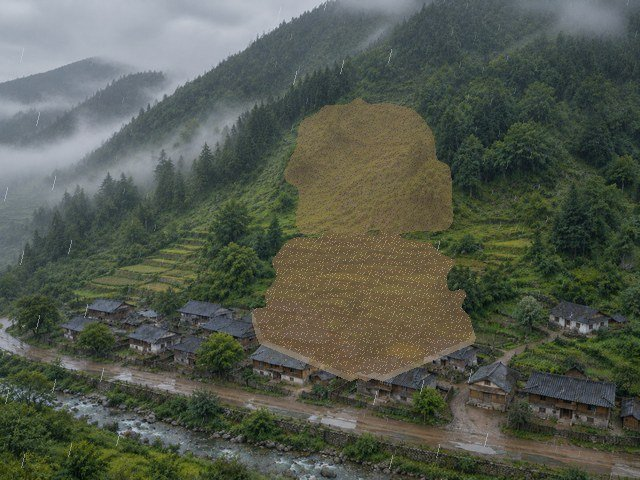 | 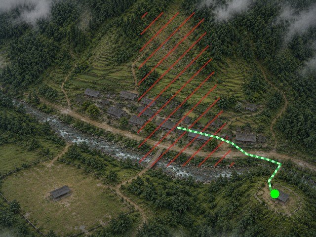 |

你要做的，就是在 4 张原图上**圈出这些东西在哪里、什么时候出现**。动画效果（变暗、裂开、滚石、流动的虚线……）全部由板子自动生成，你不用画。

### 先记住三个概念

1. **区域**：你画的东西"是什么"，比如"裂缝""滑坡体""危险区"。区域不同，板上的效果就不同。区域在参数框的下拉菜单里选。
2. **时刻 t0 → t1**：东西"什么时候出现"。每张图从 0 播到 239，大约 30 个时刻是 1 秒。t0 是开始出现，t1 是完全出现。
3. **后画的盖住先画的**：同一张图里，形状有重叠时，后画的显示在上面。所以**先画大块的底层，再画小的细节**，例如先画滑坡体，最后画裂缝。

---

## 第 1 步：认识界面

双击 `tools/annotate_scene.exe`。第一次启动要等几秒；如果杀毒软件拦截，选"允许"。

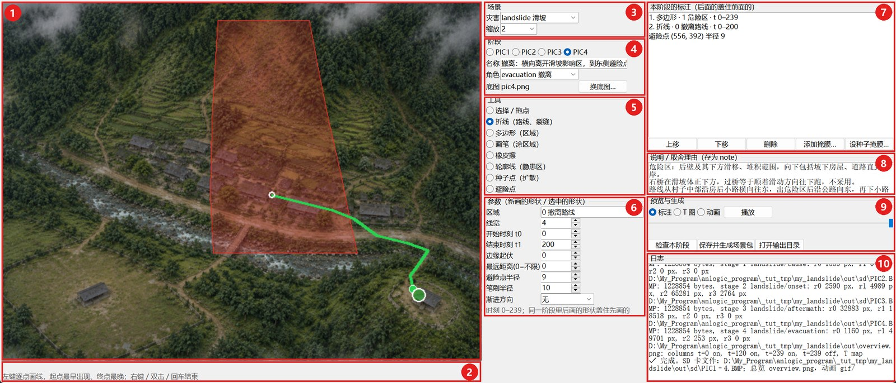

| 编号 | 名称 | 用来做什么 |
|---|---|---|
| 1 | 画布 | 在这里点 |
| 2 | 状态栏 / 提示 | 上面一行显示鼠标所在的**坐标 x、y**，对照教程里的坐标时看这里；下面一行提示当前工具怎么用 |
| 3 | 场景 | 灾害类型；画布缩放（屏幕小就选 1 或 1.25） |
| 4 | 阶段 | 点 PIC1–PIC4 **切换正在画哪张图**；"名称"写一句话描述这个阶段 |
| 5 | 工具 | 选择用哪种笔：折线、多边形、画笔…… |
| 6 | 参数 | **画之前先在这里设好**：区域、时刻、线宽等 |
| 7 | 标注列表 | 这张图上已经画了哪些东西。点一行可以选中它，再修改或删除 |
| 8 | 说明 | 写下这样画的理由，答辩用 |
| 9 | 预览与生成 | 切换"标注 / T 图 / 动画"三种看法；检查；生成 SD 卡文件 |
| 10 | 日志 | 所有提示和报错都在这里，**出问题先看这里** |

### 每画一个形状，都是同样 5 步

1. **选阶段**：区域 4，点 PIC1–PIC4。
2. **选工具**：区域 5。
3. **设参数**：区域 6，按教程表格逐项填。
4. **在画布上按顺序左键点**：对照截图里的数字，看状态栏的 x、y，差几个像素没关系。
5. **右键**结束（也可以双击，或按回车）。列表里会多出一行。

点错了就按 **Ctrl+Z** 撤销；画到一半想放弃，按 **Esc**。

> ⚠ **最容易出错的地方**：在列表里点选过某一行之后，参数框显示的是**那个形状**的参数，这时改参数会改掉那个形状。要画新东西，先按 **Esc** 取消选中，再设参数。每画完一个形状，工具会自动取消选中，所以按教程顺序一路画下去不会遇到这个问题。

---

## 第 2 步：新建场景

1. 先在 `tools/scenes/` 下新建一个空文件夹，比如 `my_landslide`。
2. 在工具菜单里点 **文件 → 新建场景…**，选中这个文件夹。
3. 灾害类型选 **landslide 滑坡**。
4. 选图片：进入 `tools/scenes/landslide_village/`，按住 Ctrl 选中 `pic1.png`、`pic2.png`、`pic3.png`、`pic4.png` 这 4 张，点打开。

日志里出现"已打开 …/my_landslide/scene.yaml"就成功了，画布上显示的是第 1 张图。

> 以后用自己的图片时，把 4 张图按 `1_….png`、`2_….png`、`3_….png`、`4_….png` 命名，工具会按文件名顺序对应 PIC1–PIC4。

---

## 第 3 步：PIC1 致因——圈出隐患坡体

**要表达**：持续强降雨，山坡中部裸露黄土的那片坡体是隐患区。雨丝是自动加上的，你只需要圈出隐患区。

1. 阶段选 **PIC1**，名称填 `致因：持续强降雨，坡体饱水`。
2. 工具选 **轮廓线（隐患区）**。
3. 参数：区域 `0 隐患区轮廓`（选轮廓线工具时会自动选好），线宽 `3`。
4. 沿着裸露黄土坡体的边缘，按下图的顺序点 9 个点，最后右键闭合：

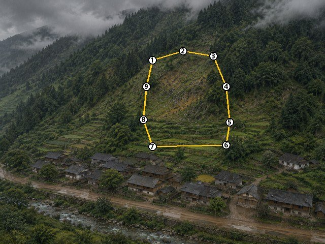

| 点 | 1 | 2 | 3 | 4 | 5 | 6 | 7 | 8 | 9 |
|---|---|---|---|---|---|---|---|---|---|
| x | 300 | 360 | 420 | 445 | 452 | 445 | 300 | 282 | 288 |
| y | 118 | 100 | 110 | 170 | 240 | 285 | 288 | 235 | 170 |

5. **看效果**：区域 9 点"动画"，再点"播放"。雨越下越密，黄色虚线框沿边流动、慢闪，和第 0 步的图一样。看完点"暂停"，切回"标注"。

---

## 第 4 步：PIC2 发生——坡体开裂、下滑（最复杂的一张）

**要表达**：按照真实滑坡的发展顺序：

| 时刻 | 发生什么 | 对应画法 |
|---|---|---|
| 0–45 | 坡顶后缘拉开裂缝，从中间向两侧延伸 | 4.5 后缘裂缝 |
| 45–100 | 坡体两侧出现剪切裂缝 | 4.6 侧缘裂缝 |
| 65–135 | 整个坡体自上而下变暗下沉，后缘露出新鲜黄土 | 4.1 滑坡体、4.2 主滑壁 |
| 80 起 | 石块从坡上滚落 | 4.4 落石 |
| 85–131 | 坡体内出现横向拉张裂缝 | 4.7 横向裂缝 |
| 125–160 | 坡脚被推挤出隆起的新土 | 4.3 前缘隆起 |

**画的顺序与发生顺序相反**：先画大的、在底层的滑坡体，最后画裂缝，这样裂缝才会显示在最上面。

阶段选 **PIC2**，名称填 `发生：坡顶拉裂、坡体下滑、落石`。

### 4.1 滑坡体（多边形）

工具选 **多边形（区域）**，参数如下：

| 区域 | 开始时刻 t0 | 结束时刻 t1 | 边缘起伏 | 渐进方向 |
|---|---|---|---|---|
| `2 滑坡体` | 65 | 135 | 6 | 自上而下 |

沿整个滑动坡体的外缘点 11 个点，右键闭合：

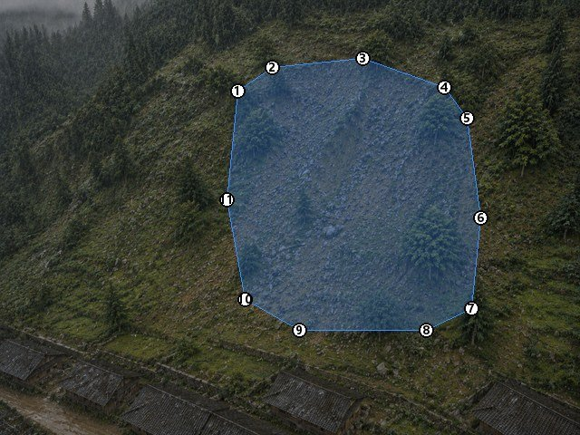

| 点 | 1 | 2 | 3 | 4 | 5 | 6 | 7 | 8 | 9 | 10 | 11 |
|---|---|---|---|---|---|---|---|---|---|---|---|
| x | 262 | 300 | 400 | 490 | 515 | 530 | 520 | 470 | 330 | 270 | 250 |
| y | 100 | 74 | 64 | 96 | 130 | 240 | 340 | 364 | 364 | 330 | 220 |

"渐进方向：自上而下"的意思是：从第 65 时刻起，坡体从上往下一片片变暗，到第 135 时刻全部变暗。"边缘起伏"让边缘不那么整齐。

### 4.2 主滑壁（画笔）

主滑壁是后缘裂缝下方露出的一条新鲜黄土带，形状是弧形的，用画笔涂最方便。

1. 工具选 **画笔（涂区域）**，参数如下：

| 区域 | t0 | t1 | 边缘起伏 | 渐进方向 | 笔刷半径 |
|---|---|---|---|---|---|
| `1 新鲜土体` | 65 | 125 | **0** | 自上而下 | 10 |

2. 在坡体顶部、紧贴滑坡体上沿，**按住左键**从左端 (266, 100) 经过顶部 (380, 64)，一直涂到右端 (512, 124)，涂成一条宽 15–25 像素的弧形带，像下图顶部的红色带子。可以分几笔涂；涂多了就换**橡皮擦**擦掉。

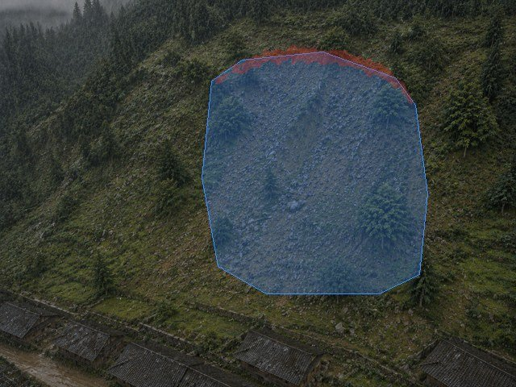

3. 涂完按 **Esc**。涂的时候这一块一直处于选中状态，不按 Esc 的话，下一步还会接着涂在它上面。

### 4.3 前缘隆起（多边形）

工具选 **多边形**，参数如下：

| 区域 | t0 | t1 | 边缘起伏 | 渐进方向 |
|---|---|---|---|---|
| `1 新鲜土体` | 125 | 160 | 3 | 自上而下 |

沿坡脚画一条细长的带子（8 个点，挨得比较近，可以把画布放大到 2 倍再点）：

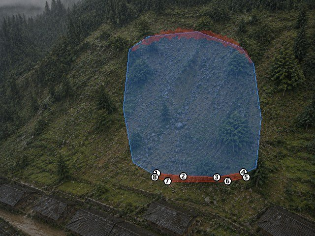

| 点 | 1 | 2 | 3 | 4 | 5 | 6 | 7 | 8 |
|---|---|---|---|---|---|---|---|---|
| x | 318 | 372 | 440 | 494 | 500 | 462 | 340 | 314 |
| y | 352 | 358 | 360 | 350 | 360 | 368 | 368 | 360 |

### 4.4 落石（3 条折线）

工具选 **折线（路线、裂缝）**，参数如下：

| 区域 | 线宽 | t0 | t1 | 边缘起伏 | 渐进方向 |
|---|---|---|---|---|---|
| `3 落石` | 4 | 0 | 239 | 0 | 无 |

**从坡上往坡下**画 3 条线，每条画完都右键结束。图中数字标出的是每条线的起点：

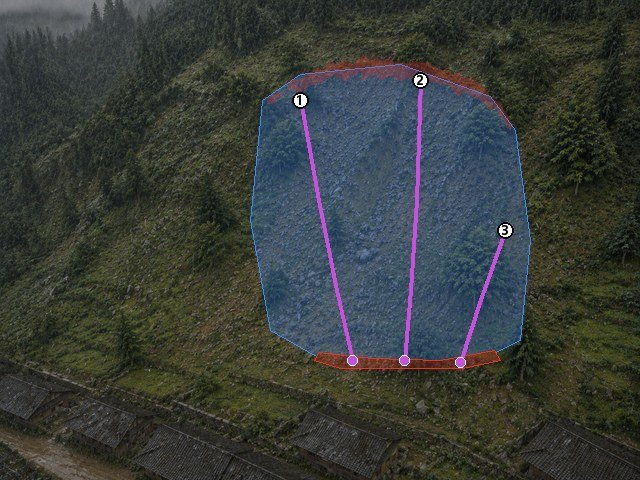

| 线 | 依次点击的坐标 |
|---|---|
| 第 1 条 | (300, 100) → (318, 200) → (336, 290) → (352, 360) |
| 第 2 条 | (420, 80) → (416, 200) → (410, 290) → (404, 360) |
| 第 3 条 | (505, 230) → (480, 300) → (460, 362) |

板子从第 80 时刻起，让石块沿这些线一颗颗滚下来。线本身不显示，只显示滚动的石块和扬起的尘土。

### 4.5 后缘裂缝（2 条折线）

两条裂缝都从坡顶中间的同一点 (380, 58) 出发，分别向左、向右延伸。工具仍是 **折线**，参数如下：

| 区域 | 线宽 | t0 | t1 |
|---|---|---|---|
| `0 裂缝` | 3 | 0 | 45 |

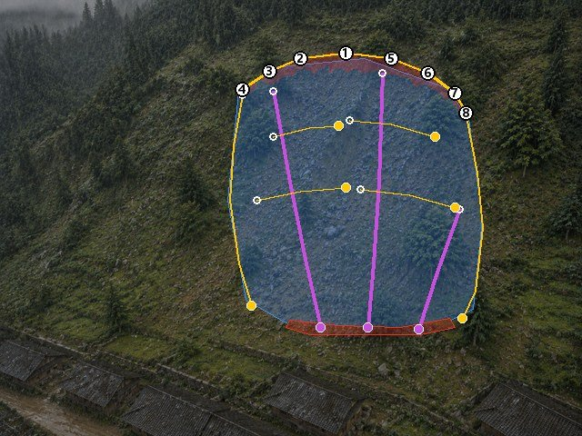

- 向左的一条：点 **1 → 2 → 3 → 4**，即 (380, 58) → (330, 64) → (296, 78) → (266, 98)，右键结束。
- 向右的一条：点 **1 → 5 → 6 → 7 → 8**，即 (380, 58) → (430, 64) → (470, 80) → (500, 102) → (512, 124)，右键结束。

两条线的起点相同没有关系，第二条照样从点 1 起笔。

### 4.6 侧缘裂缝、4.7 横向裂缝（6 条折线）

工具仍是折线，区域仍是 `0 裂缝`，线宽改成 `2`。**每画一条之前，先按下表修改 t0、t1**：

| 裂缝 | t0 | t1 | 依次点击的坐标 |
|---|---|---|---|
| 左侧缘 | 45 | 100 | (266, 104) → (256, 160) → (252, 220) → (262, 290) → (276, 336) |
| 右侧缘 | 48 | 100 | (512, 128) → (524, 190) → (530, 250) → (522, 320) → (508, 350) |
| 横向 1 左 | 85 | 105 | (300, 150) → (340, 140) → (372, 138) |
| 横向 1 右 | 89 | 110 | (384, 132) → (430, 136) → (478, 150) |
| 横向 2 左 | 105 | 127 | (282, 220) → (330, 210) → (380, 206) |
| 横向 2 右 | 109 | 131 | (396, 208) → (450, 214) → (500, 228) |

全部画完后，"标注"视图应该是这样：滑坡体（蓝）、新鲜土体（红）、落石（紫）、裂缝（黄）。

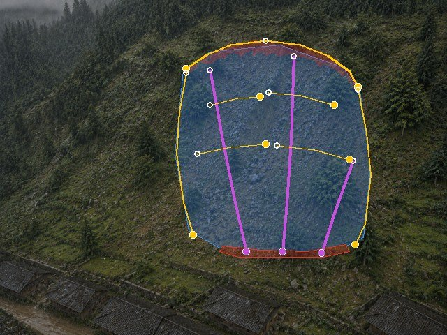

此时列表里一共有 **14 行**。

> 横向裂缝每道分成左右两截，时刻也稍微错开，这样看起来像真实的断续裂缝，而不是一刀切开。

### 4.8 看效果

切到"动画"，点"播放"；也可以拖动时刻滑条，停在下面几个时刻对照：

| t = 40：后缘裂缝出现 | t = 100：坡体开始变暗下沉 | t = 160：滑动完成 |
|---|---|---|
| 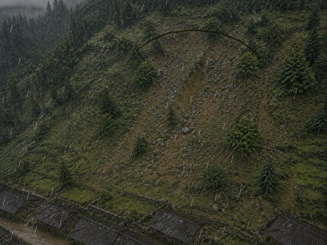 | 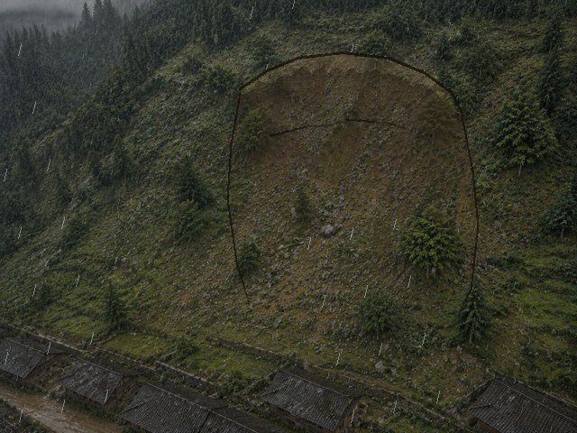 |  |

如果某样东西没出现，点"检查本阶段"，看日志里那个区域的像素数是不是 0。是 0 就说明区域选错了：在列表里选中它，把区域改对即可。

---

## 第 5 步：PIC3 后果——堆积体掩埋坡脚

**要表达**：坡体滑塌后，堆积体从坡脚向下扩展，盖过梯田和坡下的房屋，止于道路；坡上留下露出黄土的滑坡后壁。

阶段选 **PIC3**，名称填 `后果：坡体滑塌，堆积掩埋坡脚房屋和道路`。

### 5.1 堆积体（种子点 + 画笔）

堆积体的做法是"从起点向四周扩散"：先放起点（种子点），再用画笔涂出它最远能扩散到的范围。

1. 工具选 **种子点（扩散）**，参数：区域 `0 堆积体`，t0 `0`，t1 `239`，最远距离 `0`。
2. 在坡脚中部点 3 个点：(350, 252)、(366, 252)、(382, 252)，右键结束。日志会提示"种子点没有掩膜…"，这是正常的，下一步就给它涂范围。
3. 在**列表**里点选刚才那一行"1. 种子点 · 0 堆积体"。
4. 工具切到 **画笔**（选中状态会保留），笔刷半径调到 `20`（也可以按 `]` 键放大）。
5. 从种子点往下涂：盖过梯田和坡下的房屋，下沿到道路为止（大约 y = 420），左右大约在 x 280–470 之间，上窄下宽。涂成下图中黄色区域的样子：

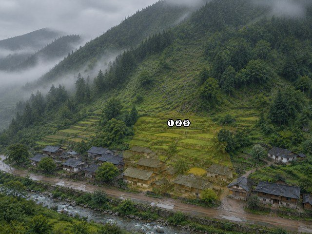

6. 涂完按 **Esc**。

板上的效果是：堆积体从 3 个种子点开始，在你涂的范围内一点点向外扩展，越晚到的地方离种子点越远。

### 5.2 滑坡后壁（多边形）

工具选 **多边形**，参数如下：

| 区域 | t0 | 边缘起伏 | 渐进方向 |
|---|---|---|---|
| `1 滑坡后壁` | 0 | 5 | 无 |

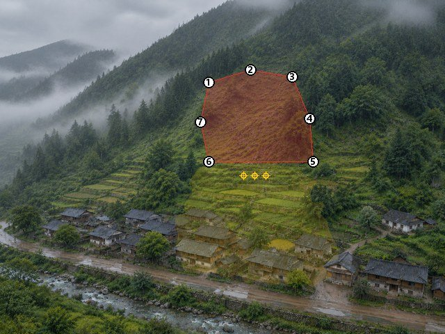

| 点 | 1 | 2 | 3 | 4 | 5 | 6 | 7 |
|---|---|---|---|---|---|---|---|
| x | 300 | 360 | 420 | 445 | 450 | 300 | 288 |
| y | 118 | 100 | 110 | 170 | 232 | 232 | 175 |

切到"动画"看一下：后壁一开始就在；堆积体从坡脚慢慢铺开，盖住梯田和房屋。

---

## 第 6 步：PIC4 撤离——往哪里跑（最重要）

**要表达**：滑坡的危险区是**滑坡体，以及它下方的滑移、堆积范围**。所以：
- 不能往坡下跑，坡下是堆积区；
- 不能过石桥，桥正好在滑坡体正下方，过桥等于顺着滑动方向往下跑；
- 应该**横向离开**滑坡影响区，往东走到避险棚。

阶段选 **PIC4**，名称填 `撤离：横向离开滑坡影响区，到东侧避险点`。

### 6.1 危险区（多边形）

工具选 **多边形**。撤离阶段的多边形默认区域就是 `1 危险区`。另外设边缘起伏 `0`，渐进方向 `无`。

沿滑坡后壁向下，一直包到坡下房屋、道路和河岸，点 10 个点：

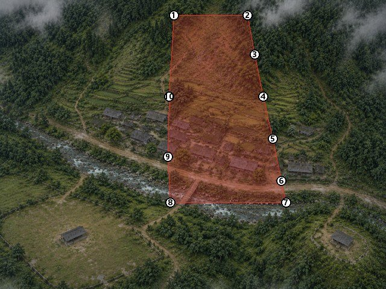

| 点 | 1 | 2 | 3 | 4 | 5 | 6 | 7 | 8 | 9 | 10 |
|---|---|---|---|---|---|---|---|---|---|---|
| x | 288 | 410 | 422 | 436 | 452 | 466 | 474 | 282 | 278 | 280 |
| y | 25 | 25 | 90 | 160 | 230 | 300 | 336 | 336 | 260 | 160 |

### 6.2 撤离路线（折线）

工具选 **折线**。撤离阶段的折线默认区域是 `0 撤离路线`，t1 默认是 200。再设线宽 `4`，t0 `0`。

**从村子画向避险棚**：画反的话，路线动画会从避险棚往村子里流。路线沿着房后的小路横向往东，出了危险区再沿公路向东，最后下小路到避险棚：

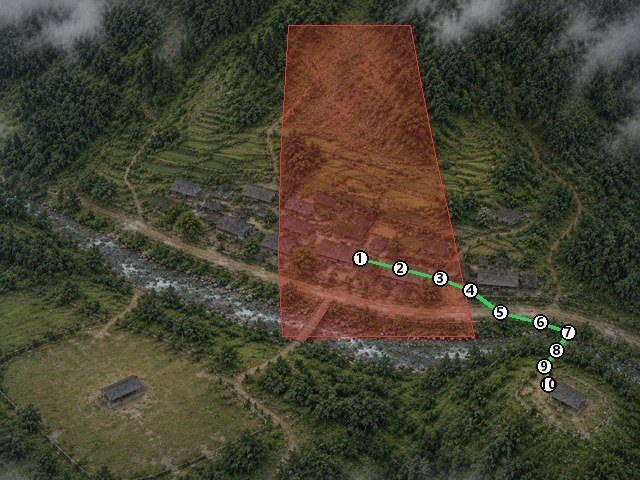

| 点 | 1 | 2 | 3 | 4 | 5 | 6 | 7 | 8 | 9 | 10 |
|---|---|---|---|---|---|---|---|---|---|---|
| x | 360 | 400 | 440 | 470 | 500 | 540 | 568 | 556 | 544 | 548 |
| y | 258 | 268 | 278 | 290 | 312 | 322 | 332 | 350 | 366 | 384 |

路线的起点在危险区里面没有关系，村子本来就在危险区里。只要**离开危险区以后不再进去**就行。

### 6.3 避险点

工具选 **避险点**，避险点半径 `9`。在避险棚上 (556, 392) 点一下，然后按 Esc。

### 6.4 写理由，然后检查

在"说明"框里写：

```
危险区：后壁及其下方滑移、堆积范围，向下包括坡下房屋、道路直到河岸。
石桥在滑坡体正下方，过桥等于顺着滑动方向往下跑，不采用。
路线从村子中部沿房后小路横向往东，出危险区后沿公路向东，再下小路到东侧避险棚。
```

点"**检查本阶段**"，日志应该显示：

```
— PIC4 撤离 —
0 撤离路线：…像素
1 危险区：…像素
2 避险点（用避险点工具）：…像素
✓ 避险点在危险区外；路线离开危险区后没有再进入
```

**画错了会怎样**：假如画了一条从东往西、又穿回危险区去过桥的路线（下图），检查会报：

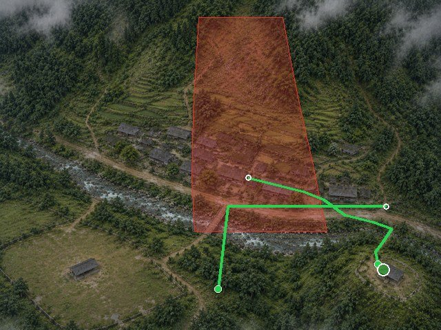

```
✗ …: route 2 re-enters the danger zone after leaving it at 828 px, x 324..466, y 298..336
```

意思是"第 2 条路线离开危险区后又进去了，位置在 x 324–466、y 298–336"。这时按 Ctrl+Z 撤销，或者在列表里选中这条路线删除，然后重新画。

---

## 第 7 步：生成并上板

1. 点"**保存并生成场景包**"（会先自动保存）。
2. 等一两分钟，日志出现"✓ 完成"就表示成功。
3. 点"**打开输出目录**"，看一下：
   - `overview.png`：4 个阶段的总览；
   - `gif/` 里的 4 个动画。
   确认和第 0 步的效果一致。
4. 把 `out/sd/` 里的 `PIC1.BMP`–`PIC4.BMP` 拷到 **SD 卡根目录**。如果卡上原来有同名文件，会被覆盖，请先备份。
5. 插卡上板。

---

## 卡住了怎么办

| 现象 | 处理 |
|---|---|
| 点了一下，没出现新点，反而某个顶点被拖动了 | 列表里还选中着某一行。按 Esc 取消选中再画 |
| 画完一个形状，参数变成了别的数 | 你在列表里点选过某一行，参数框显示的是那个形状的参数。按 Esc，再按教程重新填 |
| 画笔涂到了上一块区域上 | 上一块还处于选中状态，先按 Esc |
| 动画里某样东西不出现 | 点"检查本阶段"，那个区域像素数为 0 就是区域选错了。在列表里选中它，改区域 |
| 裂缝被滑坡体盖住了 | 在列表里选中裂缝，用"下移"把它挪到滑坡体后面（列表越靠下，显示越靠上） |
| 窗口太大，屏幕放不下 | "缩放"选 1 或 1.25 |
| 整个乱掉了 | 多按几次 Ctrl+Z。实在不行，直接关掉不保存，再用 **文件 → 打开** 重新打开 scene.yaml，回到上次保存的状态 |

---

## 做完以后：用自己的图做一张新卡

步骤完全一样，变化的只是图片和点的位置：

1. 准备 4 张同一地点的图（致因 / 发生 / 后果 / 撤离），新建场景。
2. 每个阶段按"**先大后小、先底层后细节**"的顺序画。
3. 每画完一个阶段，就切到"动画"看一遍。
4. 撤离阶段：**先画危险区，再画路线，最后放避险点**，在"说明"里写清理由，再点检查。

各种灾害分别能画哪些区域、各自的效果，见 [场景标注工具使用说明.md](场景标注工具使用说明.md) 第 6 节。

> **和仓库里原来那张滑坡卡的区别**：原卡的"发生"阶段还有坡脚扬尘、坡体内随机出现的裸露土斑、随机生成的 11 条加速滚落的落石。这些是写在 scene.yaml 里的程序化来源，工具里画不出来。所以本教程用 3 条手画的落石路线代替，并去掉了扬尘和土斑。其余部分与原卡一致。
